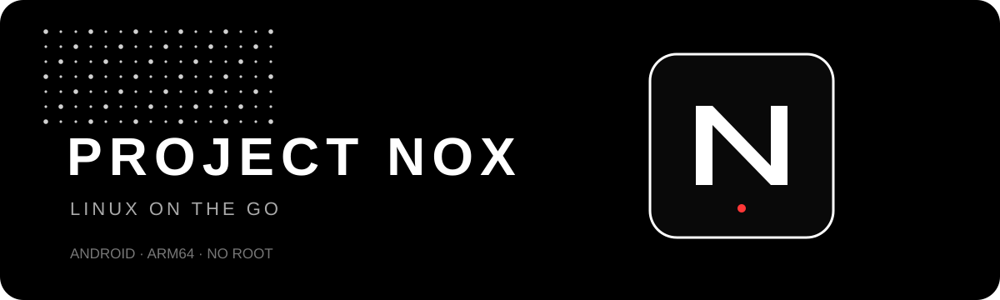

# PROJECT NOX

<p align="center">
  
</p>

<p align="center">
  <strong>A touch-first Linux desktop for Android. No root required.</strong><br/>
  Ubuntu ARM64 · XFCE goal · AMOLED-black interface
</p>

<p align="center">
  <a href="https://github.com/F1N0ZENIX/Project-Nox/actions"></a>
  <a href="https://github.com/F1N0ZENIX/Project-Nox/releases"></a>
  
  
</p>

## The idea

Project Nox aims to bring a real Linux desktop environment to Android without replacing Android or requiring root. Its visual direction is inspired by monochrome industrial design, AMOLED black, dot patterns and compact touch-friendly settings.

**This repository is under active development.** The current APK is an early Android interface prototype; it does not yet install or run Ubuntu.

## Current features

- Native Android launcher with a monochrome Nox interface.
- Settings pages for Touch Controls, Display, Linux Setup and About.
- Touchpad gesture demo with coordinate feedback.
- Adjustable pointer sensitivity, saved between launches.
- Show/hide touchpad preference, saved between launches.
- Portrait, landscape and automatic orientation actions.
- Android soft-keyboard launch.
- Automated APK compilation, GitHub Release publishing and generated changelog.

## Download the latest APK

**[Open Releases and download the latest APK](https://github.com/F1N0ZENIX/Project-Nox/releases/latest).**

Each successful push to `main` automatically builds the APK, attaches it to a new GitHub Release, and asks GitHub to generate release notes from changes since the previous release. The APK is also uploaded as a temporary Actions artifact.

## Updating Project Nox

Android permits installing a newer APK over an existing installation only when the package ID matches and both APKs are signed with the same signing key. Project Nox keeps the package ID `com.projectnox.app` and assigns a higher `versionCode` to every automated build.

The workflow now reuses a persistent development keystore from the GitHub Actions cache, so you normally can install the newer APK directly over the previous version without uninstalling it. For a stronger long-term guarantee, configure a permanent keystore using GitHub repository Actions secrets:

1. Create a signing keystore and keep a secure backup. Do not use a production key for this prototype.
2. In GitHub, open **Settings → Secrets and variables → Actions → New repository secret**.
3. Add these four secrets:
   - `NOX_KEYSTORE_BASE64`: the keystore file encoded as one Base64 string.
   - `NOX_KEYSTORE_PASSWORD`: the keystore password.
   - `NOX_KEY_ALIAS`: the key alias.
   - `NOX_KEY_PASSWORD`: the key password.
4. Push a new commit to `main`. The workflow will use that key for subsequent releases.

To encode a keystore file as Base64 on Linux, run `base64 -w 0 nox-release.keystore`. Keep the original keystore and passwords private; anyone with them can sign an APK that Android treats as an update to this app. If Android reports a signature mismatch, the installed APK was signed with a different key; uninstall that old build once, then install the latest Release.

## Roadmap

- [x] Android project and automated debug build
- [x] Touch-first navigation and initial Nox design
- [x] App-window insets fix for devices using edge-to-edge layouts
- [x] Launcher icon and improved README
- [x] Automatic Releases, APK attachment and generated release notes
- [x] Increasing version codes for automated builds
- [x] Reuse a persistent development signing key for automated builds
- [ ] Ubuntu ARM64 userspace bootstrap using PRoot
- [ ] Download/extract progress, cancellation and storage checks
- [ ] Start/stop lifecycle for the Linux environment
- [ ] XFCE desktop display integration
- [ ] Forward touch, mouse and keyboard input to Linux
- [ ] Audio and desktop session testing

## Build locally

Requirements: JDK 17 and Android SDK platform 35.

```bash
git clone https://github.com/F1N0ZENIX/Project-Nox.git
cd Project-Nox
gradle --no-daemon assembleDebug
```

APK output: `app/build/outputs/apk/debug/app-debug.apk`. A local debug build uses the machine's local debug key unless the signing environment variables are configured.

## Device target

- Initial target: ARM64 Android phones, including Nothing Phone (1).
- Minimum Android version: Android 8.0 (API 26).
- Root access is not part of the design.

## Project status and honesty

The touchpad on the current screen is a gesture demo inside the Android app. It does not move a Linux cursor yet. Ubuntu installation, a Linux graphics backend, real input forwarding and audio remain future milestones.

Project Nox is an independent project. It is not affiliated with Nothing or DroidDeck; those names are used only to describe design inspiration.
